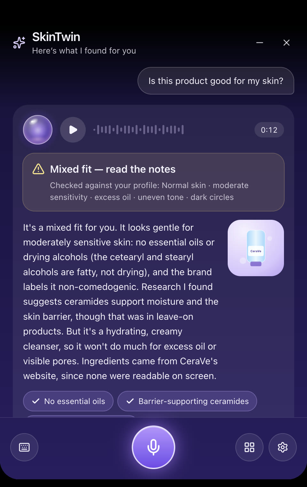
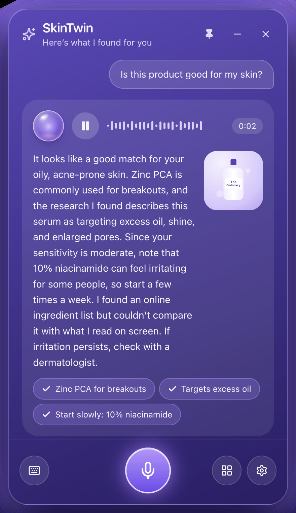
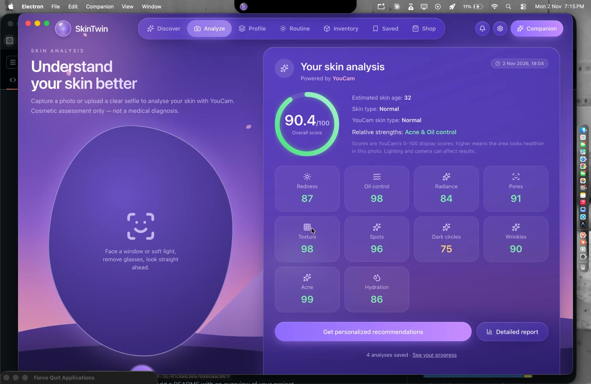
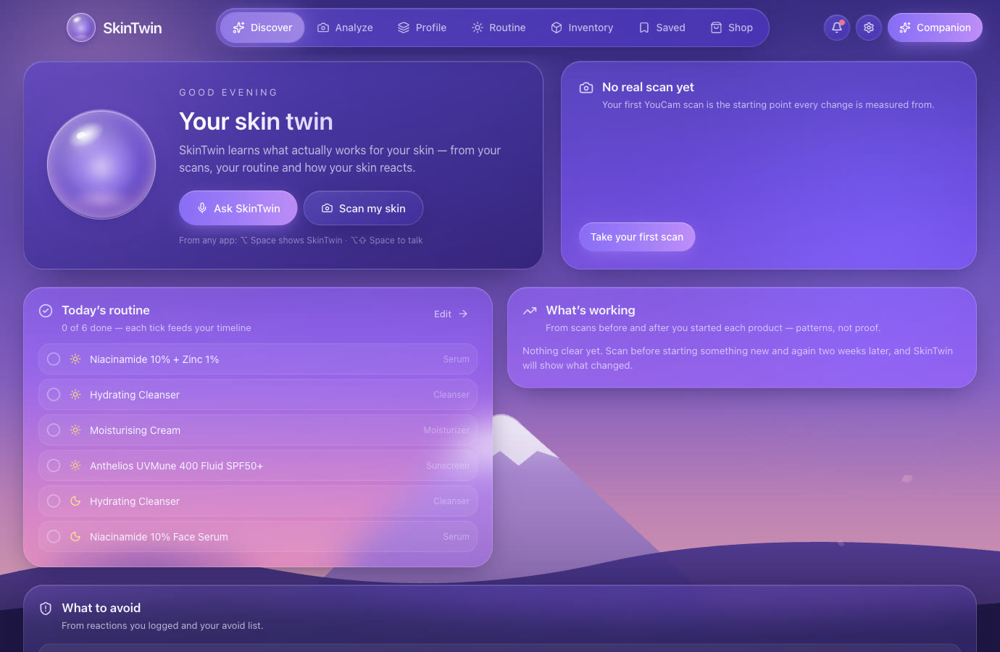
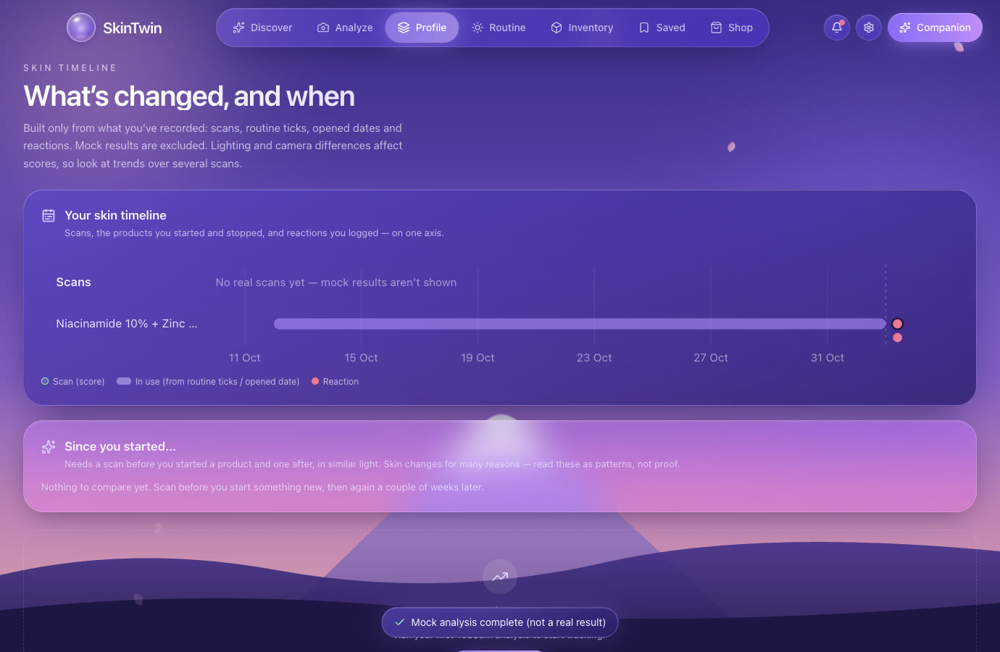
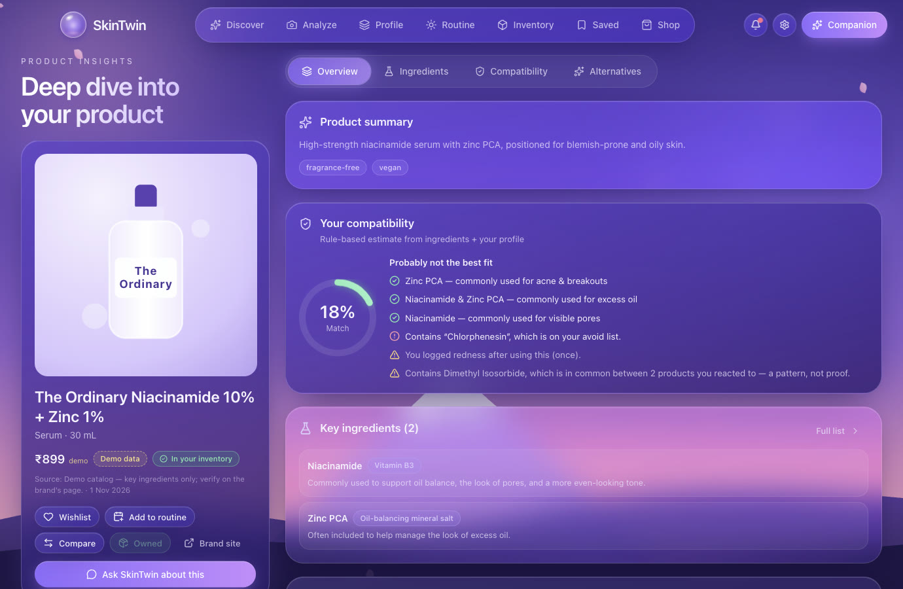
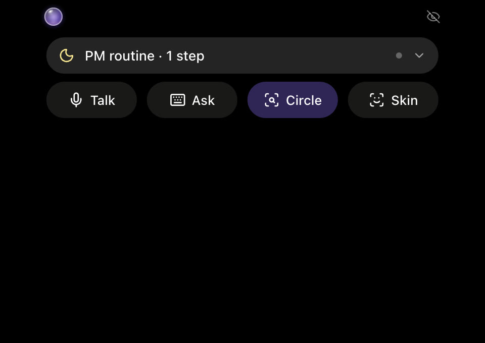
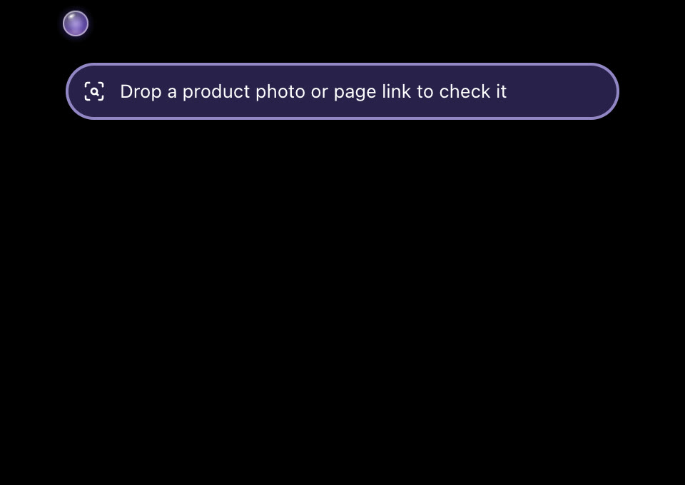

# SkinTwin

**SkinTwin learns what actually works for your skin.**

A desktop skincare companion for macOS. It measures your skin from an honest, unfiltered selfie (YouCam skin AI), checks any product you circle on screen against *your* profile with real, sourced research (Claude), and lives in a Dynamic Island around your MacBook's notch, so the verdict is one glance away.

<p align="center">
  
</p>

## The problem

People buy skincare by guessing: a friend's tip, an influencer's favourite, a five-star review. Ingredient lists are hard to read, selfie apps run beauty filters, and a lot of online advice is sponsored or simply made up. Money gets wasted, and sometimes skin gets hurt.

## What SkinTwin does

| | |
|---|---|
| **Honest skin analysis** | A camera face guide checks distance, angle and lighting, and warns about beauty filters and Mac video effects, before anything is sent. YouCam's skin AI measures 10 concerns (hydration, oil, pores, texture, redness, radiance, wrinkles, dark circles, spots, acne) plus skin type and skin age, and shows **where** it found them on your face. The photo is never saved. |
| **Circle any product (⌥⇧C)** | Draw a circle around a product anywhere on screen, whether it's a shop page, Instagram or a photo. Claude reads it, then researches the official ingredient list and real studies, and checks everything against your profile and routine. |
| **Verdicts you can trust** | Every finding links to its source. Any link that didn't come back from a real web search is thrown away. Ingredients are never filled in from memory. A clear verdict: *good fit · mixed · not for you · can't tell yet*. |
| **Dynamic Island** | A black pill around the notch: one-line verdicts with Details, live progress, voice (on-device Whisper), quick Talk / Ask / Circle / Skin actions, and drag and drop of a product photo or link. It hides your skin info during screen sharing (privacy mode). |
| **It learns** | One-tap reactions ("this stung"), with the ingredients your reactions share spotted, honestly labelled as a pattern, not proof. Your routine as a live activity in the island. A skin timeline that connects scans, products and reactions. Expiry and running-low reminders. |
| **Also** | Skin profile, routine planner, inventory, product insights, side-by-side comparison, saved products, and a Chrome extension that sends the page you're on. |

<table>
  <tr>
    <td width="50%"><br><sub><b>Real verdict</b>: a CeraVe cleanser circled on Amazon India, checked against the user's profile.</sub></td>
    <td width="50%"><br><sub><b>Sourced research</b>: studies, brand pages and dermatology sources, each one linked.</sub></td>
  </tr>
  <tr>
    <td><br><sub><b>Skin analysis</b>: a real YouCam result.</sub></td>
    <td><br><sub><b>"Your twin" home</b>: today's routine, latest scan, what's working, what to avoid. <i>(test data)</i></sub></td>
  </tr>
  <tr>
    <td><br><sub><b>Skin timeline</b>: scans, products and reactions on one line. <i>(test data)</i></sub></td>
    <td><br><sub><b>Product insights</b>: ingredients, compatibility, alternatives. <i>(demo catalog)</i></sub></td>
  </tr>
  <tr>
    <td><br><sub><b>Routine in the island</b>: tick steps without opening the app.</sub></td>
    <td><br><sub><b>Drag and drop</b>: drop a product photo or page link to check it.</sub></td>
  </tr>
</table>

## Principles

- **Never made up.** No invented analysis results, ingredients, prices, studies or partnerships. Mocks and demo data are labelled wherever they appear.
- **Private by default.** Selfies are held in memory only and never saved. Page and screen content is treated as untrusted data. API keys live only in the main process, never in the UI bundle. Skin info is hidden from screen shares.
- **Cosmetic guidance, not medical advice.** Persistent problems point you to a dermatologist.

## Architecture

```
┌────────────── Electron main process (Node) ───────────────┐
│ db.ts — local JSON database, atomic writes, validated     │
│ services/ youcam · llm (Claude) · speech · bridge · ingest│
│ secrets from .env live ONLY here                          │
└──────┬──────────── typed IPC (preload) ───────────┬───────┘
       │                                            │
 Main window (React)                    Companion window (React)
 13 screens, top nav                    frameless, always-on-top,
                                        11-state machine, voice
       ▲
       │ http://127.0.0.1:47821  (pairing token, extension origins only)
 Browser extension (MV3) — reads the current page only when clicked
```

## Requirements

- macOS (built and tested on macOS 26; the island is designed for notched MacBooks and falls back to a floating pill on other displays)
- Node.js 22+ and npm
- Optional API keys (the app runs without them, using labelled fallbacks):
  - **Anthropic** for the assistant, circle-to-check and web research
  - **YouCam (Perfect Corp) S2S API** for skin analysis

## Configuration

Copy `.env.example` to `.env` and fill in what you have. Never commit `.env`; it's git-ignored.

| Variable | Purpose |
|---|---|
| `ANTHROPIC_API_KEY` | Claude assistant, circle-to-check, product research |
| `SKINTWIN_LLM_MODEL` | Override the Claude model (default `claude-opus-5-5`) |
| `YOUCAM_API_KEY`, `YOUCAM_API_BASE` | YouCam skin analysis |
| `STT_PROVIDER` | `local` (on-device Whisper, the default), `openai`, `elevenlabs`, or `off` |
| `STT_LOCAL_MODEL` | On-device Whisper model (default `onnx-community/whisper-base.en`) |
| `OPENAI_API_KEY`, `ELEVENLABS_API_KEY`, `ELEVENLABS_VOICE_ID`, `TTS_PROVIDER` | Optional cloud speech |
| `SKINTWIN_DEMO_CATALOG`, `SKINTWIN_ENABLE_MOCKS` | Dev-only demo catalog and mock analysis (labelled in the UI) |
| `SKINTWIN_BRIDGE_PORT` | Port for the browser-extension bridge (default 47821) |

**macOS permissions** (asked when first used): Camera (skin scan), Microphone (voice), and Screen & System Audio Recording (circle a product). While developing, grant them to **Electron**.

## Quick start

```bash
npm install
node node_modules/electron/install.js   # only if Electron's binary didn't download (npm 11 blocks install scripts)
cp .env.example .env                     # optional: add API keys
npm run dev
```

With no keys at all the app still works, including voice input (on-device Whisper): the demo catalog, rule-based product matching, routines, inventory and a clearly-labelled *mock* skin analysis are all available in dev mode.

| Command | What it does |
|---|---|
| `npm run dev` | Run with hot reload (demo catalog + mocks on) |
| `npm run build` | Production build into `out/` |
| `npm run package:mac` | Build an unsigned `SkinTwin.app` into `dist/app/` |
| `npm run typecheck` / `npm run lint` / `npm test` | Static checks + 160+ unit/integration tests |
| `npm run smoke` | Launches the real app (temp data folder), clicks through journeys A–I, writes screenshots to `dist/smoke/` |

**Browser extension:** `chrome://extensions` → Developer mode → *Load unpacked* → pick the `extension/` folder → click the toolbar icon and paste the pairing code from **Settings › Browser extension**.

**Shortcuts (from any app):** <kbd>⌥ Space</kbd> shows/hides the companion · <kbd>⌥⇧ Space</kbd> talk (press again to send). Change them in Settings › Voice & assistant. Right-click the orb for its menu; drag it and it snaps to the nearest screen corner.

## Why Electron (not Tauri)

The repository was empty, and the machine has no Rust toolchain. Electron gives everything this app needs with one language: real multi-window (floating, always-on-top, visible on all Spaces), `MediaRecorder`/camera, macOS media-permission APIs, global shortcuts, a tray, and a Node process for secrets and the local bridge. Trade-off: a larger download (~250 MB vs ~10 MB for Tauri) and higher idle memory. The UI is plain React, so moving to Tauri later only means rewriting `src/main` + `src/preload`.

## Layout

```
src/shared/      models.ts (zod schemas = the data model), mutations.ts (pure, validated reducer),
                 scoring.ts (explainable compatibility engine), ingredients.ts (reference),
                 catalog.ts (DEMO data), protocol.ts (extension messages), assistant.ts
src/main/        index.ts (windows, IPC, permissions, tray, shortcut), db.ts, config.ts,
                 services/{youcam,llm,speech,bridge,ingest}.ts
src/preload/     contextBridge API (api.d.ts is the typed contract)
src/renderer/src app/ (shell + nav), features/<screen>/, components/{ui,products}, lib/ (store, router, toast)
                 companion/ machine.ts (state machine), voice.ts, Companion.tsx, views.tsx
extension/       manifest.json, popup.*, extractor.js (JSON-LD → microdata → OpenGraph → heuristics)
tests/           vitest; scripts/smoke.mjs = Playwright driver for the real app
```

Design tokens (colors, radii, glass surfaces, motion, z-layers, focus ring) are in `src/renderer/src/styles/app.css`. UI primitives (shadcn-style, `cva` + Tailwind v4) are in `components/ui`. Animation uses Motion.

## Screens

Onboarding (7 steps, resumable, every permission optional) · Discover · Skin Analysis · Skin Profile · Skin Progress · Routine (setup + planner + today + suggestions) · Inventory (+ restock + history) · Product Insights (overview / ingredients / compatibility / alternatives) · Comparison (side-by-side / differences / ingredient focus / recommendation) · Saved · Shop · Settings › Voice & assistant · Settings › Privacy & permissions · Settings › Browser extension.

## Companion states

`idle` → `listening` → `processing` → `responding`, plus `product_detected`, `product_analysis`, `comparison`, `quick_actions`, `profile_peek`, `permission_required`, `error`. The reducer (`companion/machine.ts`) tags every request with an id: stale or cancelled responses are dropped, and you can't submit twice while it's thinking. Orb states use a compact window; everything else expands it. It has pin/unpin, minimize, hide, drag (anywhere on the background), Esc to cancel, ⌘↵ to send, and push-to-talk or click-to-toggle.

Voice pipeline: mic opens only on activation → `MediaRecorder` (real audio-level waveform) → STT provider → context built from profile/routine/inventory/product (only what's needed; the profile can be withheld in Privacy settings) → Claude with structured output → spoken with the macOS system voice or ElevenLabs → conversation and actions saved. Voice input runs **on-device by default** (Whisper `base.en` via transformers.js + ONNX Runtime): free, no key, and audio never leaves the computer. The ~80 MB model downloads once into the app's data folder (`models/`) shortly after launch. Recordings are re-encoded to 16 kHz mono WAV in the renderer before transcription. Set `STT_PROVIDER=openai` or `elevenlabs` (with its key) to use a cloud service instead, `STT_LOCAL_MODEL` to pick another Whisper model, or `STT_PROVIDER=off` to type only.

## Data model & persistence

One local JSON document (`~/Library/Application Support/SkinTwin/skintwin-db.json`) validated by `DatabaseSchema` on load. It holds the profile, onboarding/permissions, analyses, products (with `source` provenance: `demo_catalog | browser | manual | partner`, `fetchedAt`, `verified`), inventory, AM/PM routines and steps, saved products, conversations, companion actions, partners, listings, settings, and the detected product. Every write goes through `applyMutation` (zod-validated, pure, unit-tested) in the main process, which then broadcasts the new snapshot to both windows, so they never disagree. Writes are atomic (temp file + rename) and the file is created with mode `0600`. A corrupt file is backed up and replaced rather than crashing. No migrations are needed yet (`version: 1`).

The local file was chosen over a database server because this is single-user and local-first. To add accounts and sync later, swap `Store` for a Supabase-backed implementation behind the same `mutate` API.

## Integration status

| Integration | Status |
|---|---|
| YouCam skin analysis | **Verified live** (2026-11-01): a real selfie returned all 10 requested metrics plus overall score, skin age and skin type (`skin_type`, added at no extra unit cost: 11 actions stay in the 9–12 tier), saved as a real (non-mock) result; error codes map to plain-language hints. Camera captures are cropped to the 4:5 preview so the face fills the frame YouCam sees. |
| Assistant (Claude, `claude-opus-5-5`) | **Verified live** (2026-11-01): structured answer in ~5 s, grounded in the profile and product (verdict, highlights, suggested actions). Also has a server-side refusal fallback, a 60 s timeout and cancellation. Without a key it uses a **rule-based fallback**, labelled as such. |
| Speech-to-text | **Live, on-device** (Whisper `base.en`, free, no key): verified in the dev app with a recorded clip fed through the real recorder, and in the packaged `.app`. OpenAI or ElevenLabs Scribe optional (not run live). |
| Text-to-speech | **Live**: on-device macOS voice. ElevenLabs optional (awaiting key). |
| Browser extension + bridge | **Live and tested** (token auth, origin check, schema validation). The page reader was run on real product pages (The Ordinary, CeraVe), and a real CeraVe product went bridge → companion → live Claude analysis. It refuses everything while **Settings › Browser extension › page access** is off. The toolbar click itself needs a person, so test it once by hand. |
| Circle a product (⌥⇧C) | **Live and tested** in the real app: screen capture → circle overlay → Claude reads the circled pixels → companion verdict. Ingredients are only used if they're legible in the circle (never filled in from memory); circling a product's ingredient list right after its name adds them. It then **researches the product on the web** (Claude web search + fetch): the official ingredient list and what studies, dermatology bodies and regulators say about the ingredients that matter for your profile. Every claim is shown with its source link, and any link that didn't come back from the actual search is dropped. Web search is billed per search on the Anthropic account. Needs macOS **Screen & System Audio Recording** permission for SkinTwin (Electron while developing). |
| Product catalog / marketplace | **Demo data only**, labelled everywhere: key ingredients only and illustrative prices. "Visit" opens brand homepages. There are no partnerships, offers or in-app checkout. |

## Roadmap

- Sun alerts from real UV forecasts (Open-Meteo)
- A real product catalog of brands popular in India, with real photos, full ingredient lists and sources
- One consistent product page everywhere: verdict, ingredients, research, your history, where to buy, alternatives
- A phone companion, plus a hosted backend for keys, usage limits and a shared research cache

## Test results (this build)

- `npm run typecheck`: clean · `npm run lint`: clean · `npm test`: **160+ tests pass**
- `npm run smoke`: **all checks pass**, 0 renderer errors. Covers onboarding → profile saved; routine add + reorder saved; inventory running-low → restock; mock analysis saved and flagged; bridge rejects a bad token and accepts a valid product; companion product-detected → analysis → comparison → answer (labelled) → save → appears in the main app; mark-owned; add an alternative to the evening routine; page-read failure; voice without STT.
- `npm run package:mac`: unsigned `.app` builds and launches. Production mode turns off demo data and mocks.

## Known limitations

- **Not verified live:** the cloud STT providers (on-device voice is the default).
- **Microphone capture** was tested with Chromium's fake microphone (a recorded clip), not a live mic. The OS permission prompt shows the first time you use the mic.
- **First voice use needs internet once** to download the speech model (~80 MB); after that it works offline. On-device Whisper is English-only by default.
- The **compatibility score** is a transparent rule-based estimate from ingredient lists, not a clinical assessment. The ingredient reference covers about 30 common actives and flags.
- **Demo catalog ingredient lists are partial.** Replace them with a verified catalog (`ProvenanceSchema.kind = 'partner'`) before shipping.
- Product pages that build their content late, or hide ingredients behind a click, may need a second "Check this product" click. The extractor never bypasses logins, paywalls or CAPTCHAs.
- The app is unsigned. Distributing it needs an Apple Developer ID and notarization, plus an app icon.
- The extension is Chromium-only (MV3). Firefox would need a manifest variant.
- Remaining amount and expiry are **your estimates**; the UI says so.
